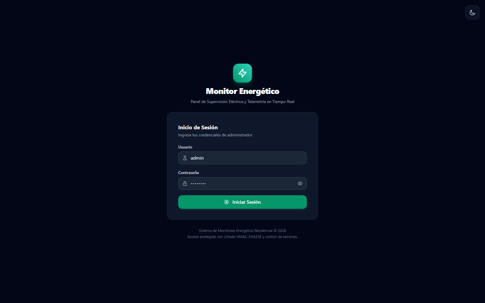
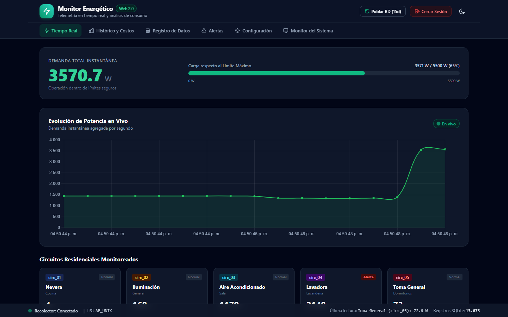
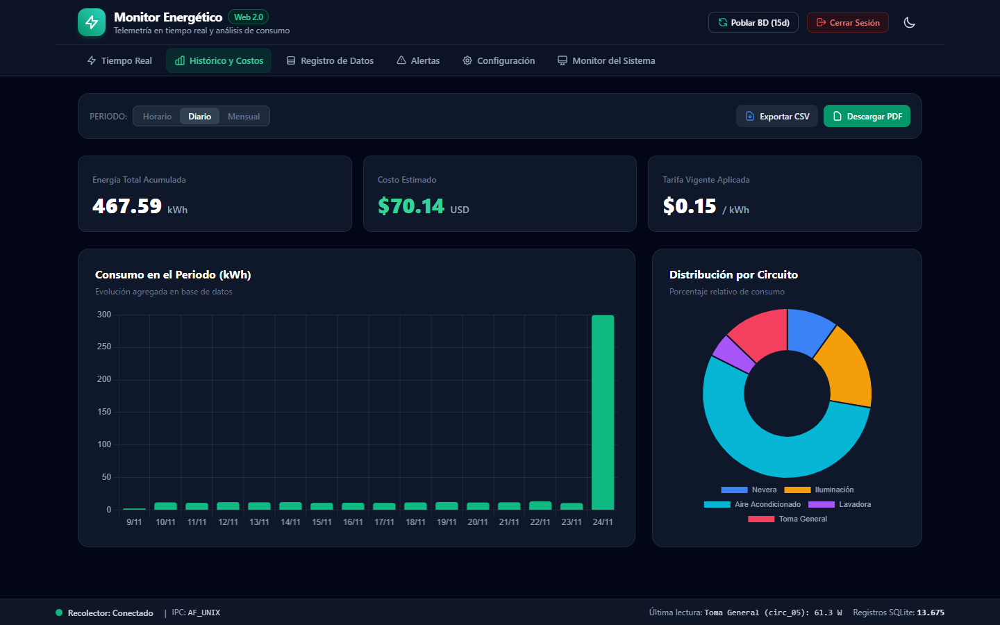
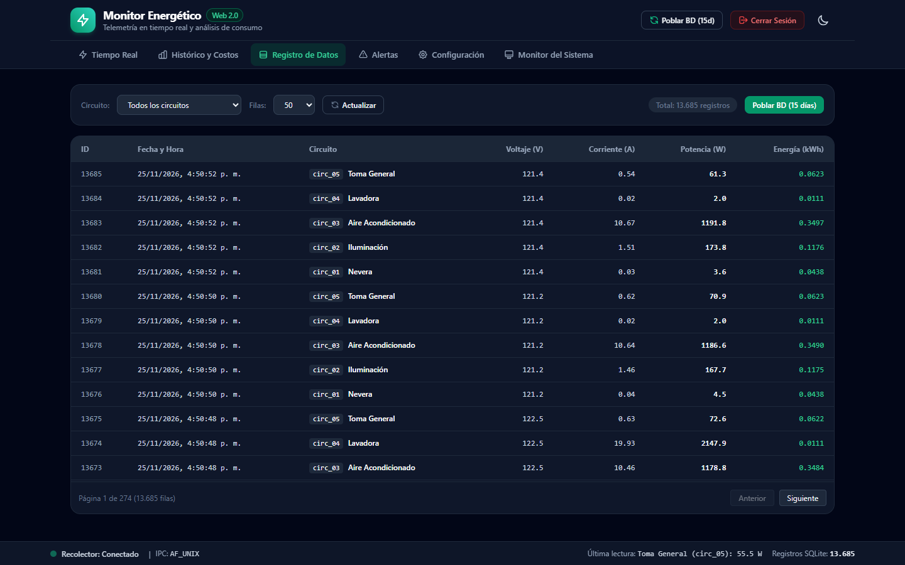
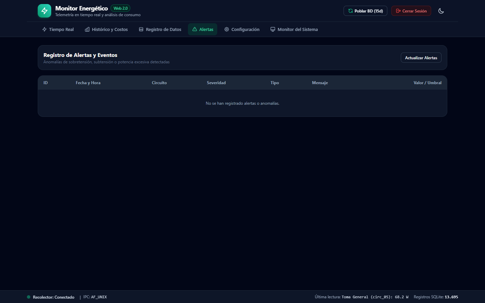
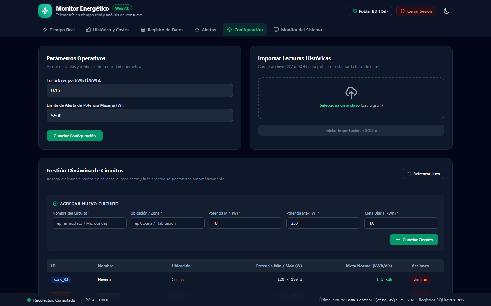
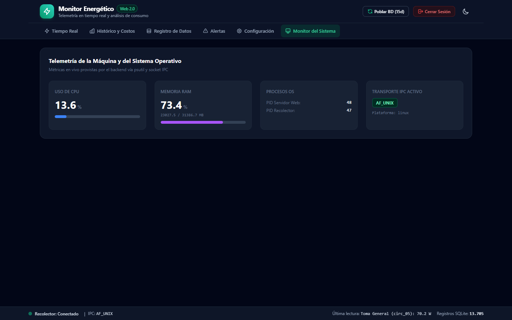

# Sistema de Monitoreo Energético para Vivienda

Sistema modular de grado industrial y multiplataforma (Windows y Linux) para el monitoreo, análisis en tiempo real, detección de anomalías y control de costos del consumo eléctrico residencial.

---

> ### 🌐 Despliegue en Producción (Web en la Nube)
>
> La plataforma se encuentra desplegada y operativa en la nube para acceso público:
>
> - **Enlace Público en Render**: [https://monitoreo-energetico.onrender.com](https://monitoreo-energetico.onrender.com)
> - **Credenciales de Acceso por Defecto**:
>   - **Usuario**: `admin`
>   - **Contraseña**: `monitor2026`
>   *(Configurables mediante las variables de entorno `ADMIN_USER`, `ADMIN_PASSWORD` y `SESSION_SECRET`).*
>
> > [!NOTE]
> > **Disponibilidad en Nube (Free Tier)**: Al estar alojado en la capa gratuita de Render, el contenedor entra en estado de suspensión tras períodos de inactividad. La primera petición puede tomar entre **30 y 50 segundos** mientras la instancia despierta.
> > El script de inicio en la nube (`start_cloud.sh`) verifica el estado de la base de datos SQLite y, si arranca vacía, ejecuta automáticamente el poblador estadístico (`scripts/seed_realistic_data.py`), inyectando 15 días de telemetría histórica calibrada para garantizar analítica inmediata.

---

## 🚀 Características Principales

- **Arquitectura de Procesos Desacoplada (SO-01 / SO-03)**:
  - **Recolector en segundo plano (Daemon / Backend)**: Captura telemetría de circuitos eléctricos cada segundo, valida integridad física, persiste en SQLite con soporte WAL y transmite eventos en tiempo real mediante un servidor IPC dual:
    - **Linux / POSIX**: Socket de dominio Unix (`socket.AF_UNIX`) con permisos restrictivos `0o600`.
    - **Windows**: Socket TCP local en `127.0.0.1:50555`.
  - **Doble Frontend Compatible**:
    - **Interfaz Web 2.0 (FastAPI + Tailwind CSS + Chart.js + WebSockets)**: Panel reactivo con modo oscuro/claro, telemetría fluida a 1 Hz, visualización de potencia total, desglose por circuito y fallback automático REST.
    - **Dashboard de Escritorio (PySide6 + PyQtGraph)**: Aplicación gráfica nativa para estaciones de trabajo con gráficos móviles de alta frecuencia.
- **Autenticación y Seguridad de Sesión Web**:
  - Control de acceso de usuario único con cookies HTTP-only firmadas criptográficamente con `HMAC-SHA256`.
  - Protección de rutas HTML, endpoints REST y canales WebSocket.
  - **Blindaje contra el botón "Atrás"**: Cabeceras `Cache-Control: no-cache, no-store, must-revalidate` junto con detección en JavaScript del evento `pageshow` (`event.persisted`), previniendo el acceso no autorizado desde la caché del navegador al cerrar sesión.
- **Gestión Dinámica de Circuitos en Caliente**:
  - CRUD completo de circuitos desde la interfaz web (`GET`, `POST`, `DELETE` en `/api/circuits`).
  - Creación y eliminación dinámica con propagación inmediata al simulador del recolector sin requerir reinicio del servicio.
  - Calibración por defecto según perfiles realistas de consumo residencial en kWh/día.
- **Calibración Estadística y Generador de Telemetría Realista**:
  - Centralización de perfiles en `src/common/profiles.py` con metas diarias en kWh:
    - **Nevera (`circ_01`)**: 120 – 180 W (1.5 kWh/día, ciclos periódicos).
    - **Iluminación (`circ_02`)**: 60 – 180 W (0.9 kWh/día, picos matutinos y nocturnos).
    - **Aire Acondicionado (`circ_03`)**: 900 – 1500 W (6.0 kWh/día, uso vespertino/nocturno).
    - **Lavadora (`circ_04`)**: 400 – 700 W (1.0 kWh/día, ciclos discretos de lavado).
    - **Toma General (`circ_05`)**: 40 – 350 W (1.6 kWh/día, standby y picos variables).
- **Reportes y Exportación Profesional**:
  - **Exportación CSV Excel**: Codificación `utf-8-sig` (UTF-8 con BOM), delimitador punto y coma (`;`), encabezados descriptivos en español y formato numérico con decimales estándar.
  - **Generación de Reporte PDF**: Informe mensual formal generado con ReportLab incluyendo resumen ejecutivo, desglose por circuito y gráficos.
- **Métricas de Salud del Sistema Operativo (SO-09)**:
  - Monitoreo en vivo de consumo de CPU, memoria RAM (vía `psutil`), estado de transporte IPC, recuento de registros en SQLite y tiempo de actividad.

---

## 📸 Capturas de Pantalla de la Aplicación en Producción

Las siguientes capturas corresponden a la versión activa en la nube ([https://monitoreo-energetico.onrender.com](https://monitoreo-energetico.onrender.com)):

| Módulo / Pestaña | Vista en Producción |
| :--- | :--- |
| **Inicio de Sesión Seguro (`/login`)** |  |
| **Telemetría en Tiempo Real (WebSocket 1 Hz)** |  |
| **Histórico, Indicadores y Control de Costos** |  |
| **Registro de Datos Paginados en SQLite** |  |
| **Historial de Alertas y Anomalías Estadísticas** |  |
| **Configuración y Gestión Dinámica de Circuitos** |  |
| **Monitoreo de Recursos del Sistema (SO-09 / psutil)** |  |

---

## 📁 Estructura del Proyecto

```text
MONITOREO/
├── config/
│   └── default_config.json        # Configuración inicial de tarifas, circuitos y retención
├── docs/
│   ├── INFORME_TECNICO.md         # Informe técnico detallado de arquitectura y SO
│   └── screenshots/               # Evidencia visual de los 7 módulos en producción
├── packaging/
│   ├── assets/
│   │   └── monitor-energetico.png # Icono oficial en alta resolución (256x256 PNG)
│   ├── pyinstaller.spec           # Especificación PyInstaller para binarios independientes
│   ├── build_packages.py          # Script de empaquetado automatizado
│   ├── windows/
│   │   ├── start_collector.bat    # Script de inicio del recolector en Windows
│   │   ├── start_dashboard.bat    # Script de inicio del dashboard PySide6 en Windows
│   │   ├── start_web.bat          # Script de inicio del servidor web en Windows
│   │   └── install_service.bat    # Registro como tarea programada en Windows
│   └── linux/
│       ├── energy-collector.service   # Unidad de servicio systemd para Linux
│       ├── monitor-energetico.desktop # Lanzador FreeDesktop para menú de aplicaciones
│       ├── install.sh             # Script de instalación integral para Linux
│       ├── uninstall.sh           # Script de desinstalación limpia y purga opcional
│       ├── start_collector.sh     # Script de inicio del recolector en Linux
│       ├── start_dashboard.sh     # Script de inicio del dashboard PySide6 en Linux
│       └── start_web.sh           # Script de inicio del servidor web en Linux
├── samples/
│   ├── lecturas_ejemplo.csv       # Muestra de telemetría para pruebas de importación
│   └── lecturas_ejemplo.json      # Muestra en formato JSON
├── scripts/
│   └── seed_realistic_data.py     # Generador/poblador de telemetría realista (15 días, perfiles kWh)
├── src/
│   ├── common/                    # Núcleo compartido
│   │   ├── config_manager.py      # Gestor de configuración multihilo con recarga en caliente
│   │   ├── database.py            # SQLite WAL con agregaciones e índices optimizados
│   │   ├── logger.py              # Logging rotativo (RotatingFileHandler) y consola
│   │   ├── models.py              # Dataclasses de Circuit, Reading, Alert, AggregateReading
│   │   ├── paths.py               # Rutas nativas XDG/AppData y permisos seguros (0o600/0o700)
│   │   └── profiles.py            # Perfiles realistas de consumo normal en kWh (fuente única de verdad)
│   ├── collector/                 # Proceso 1: Recolector en segundo plano
│   │   ├── main.py                # Entrada ejecutable (patrón Productor-Consumidor con Queue)
│   │   ├── simulator.py           # Simulador de telemetría con perfiles de carga domiciliarios
│   │   ├── validator.py           # Validador de rangos físicos y duplicados (ReadingValidator)
│   │   ├── ipc_server.py          # Servidor IPC dual multiplataforma (AF_UNIX en Linux, TCP en Windows)
│   │   └── aggregator.py          # Hilo programado de agregaciones y retención periódica
│   ├── dashboard/                 # Proceso 2: Dashboard de escritorio (PySide6)
│   │   ├── main.py                # Punto de entrada de la interfaz gráfica de escritorio
│   │   ├── ipc_client.py          # Cliente IPC dual en QThread con reconexión automática continua
│   │   ├── cost_calculator.py     # Motor de cálculo de tarifas fijas, horarias (TOU) y por tramos
│   │   ├── anomaly_detector.py    # Detección de anomalías estadísticas (> 2 desviaciones estándar)
│   │   ├── theme.py               # Gestor de estilos CSS y temas Claro y Oscuro
│   │   ├── reports/               # Módulo de reportes y exportación
│   │   │   ├── exporter.py        # Exportación CSV, capturas PNG e importación CSV/JSON
│   │   │   └── pdf_report.py      # Generador de reportes mensuales en PDF con ReportLab
│   │   └── ui/                    # Pestañas y componentes visuales PySide6
│   └── web/                       # Proceso 3: Servidor Web 2.0 (FastAPI + WebSockets)
│       ├── app.py                 # Aplicación FastAPI, puente IPC asíncrono y endpoints REST/WS
│       ├── auth.py                # Módulo de autenticación, HMAC-SHA256 y protección de caché
│       └── templates/
│           ├── index.html         # SPA reactiva con Tailwind CSS, Chart.js y WebSockets
│           └── login.html         # Pantalla de login moderna con bloqueo de navegación previa
├── tests/                         # Suite de pruebas automatizadas (56 tests unitarios e integración)
├── render.yaml                    # Configuración de infraestructura como código para Render
├── requirements-web.txt           # Dependencias optimizadas para despliegue web en nube
├── requirements.txt               # Dependencias completas (incluye PySide6 para escritorio)
├── start_cloud.sh                 # Orquestador multi-proceso para producción en Linux (Render)
└── README.md                      # Documentación principal del proyecto
```

---

## 🛠️ Instalación y Puesta en Marcha Local

### 1. Requisitos Previos
- **Python 3.10 o superior** instalado.
- Entorno Windows 10/11 o distribución Linux (Ubuntu, Debian, Fedora, Arch, etc.).

### 2. Preparación del Entorno Virtual

#### En Windows (PowerShell):
```powershell
python -m venv .venv
.\.venv\Scripts\Activate.ps1
pip install -r requirements.txt
```

#### En Linux (Bash):
```bash
python3 -m venv .venv
source .venv/bin/activate
pip install -r requirements.txt
```

---

## 💻 Ejecución Local de los Componentes

### Opción A: Interfaz Web (Recomendada)

Permite ejecutar el sistema completo con interfaz web en navegador:

#### En Windows:
```cmd
REM Terminal 1: Iniciar el recolector
packaging\windows\start_collector.bat

REM Terminal 2: Iniciar el servidor web
packaging\windows\start_web.bat
```

#### En Linux:
```bash
# Terminal 1: Iniciar el recolector
chmod +x packaging/linux/start_collector.sh
./packaging/linux/start_collector.sh

# Terminal 2: Iniciar el servidor web
chmod +x packaging/linux/start_web.sh
./packaging/linux/start_web.sh
```

- **Acceso Web Local**: [http://127.0.0.1:8000](http://127.0.0.1:8000)
- **Documentación OpenAPI / Swagger**: [http://127.0.0.1:8000/docs](http://127.0.0.1:8000/docs)
- **Credenciales Locales por Defecto**: `admin` / `monitor2026`

---

### Opción B: Dashboard de Escritorio (PySide6)

Si se desea utilizar la interfaz gráfica nativa de escritorio:

#### En Windows:
```cmd
packaging\windows\start_dashboard.bat
```

#### En Linux:
```bash
./packaging/linux/start_dashboard.sh
```

---

## ☁️ Despliegue en Producción (Render)

El proyecto incluye soporte nativo para despliegue directo en **Render** como un Web Service en Linux:

### Archivos de Configuración Cloud
1. **`render.yaml`**: Archivo de Blueprint que especifica la compilación con `requirements-web.txt` (excluyendo bibliotecas GUI pesadas como `PySide6`) y el comando de arranque:
   ```yaml
   services:
     - type: web
       name: monitoreo-energetico
       env: python
       plan: free
       buildCommand: pip install -r requirements-web.txt
       startCommand: chmod +x start_cloud.sh && ./start_cloud.sh
   ```
2. **`requirements-web.txt`**: Paquete mínimo para backend y web (`fastapi`, `uvicorn[standard]`, `jinja2`, `python-multipart`, `reportlab`, `psutil`, `platformdirs`, `httpx`).
3. **`start_cloud.sh`**: Orquestador en shell POSIX para Linux que:
   - Aplica límites y crea las carpetas de datos y runtime en `~/.local/share/monitor-energetico`.
   - Si la base de datos está vacía, ejecuta `scripts/seed_realistic_data.py` para generar 15 días de telemetría histórica.
   - Lanza en segundo plano el proceso recolector (`python -m src.collector.main`) utilizando el socket de dominio Unix `AF_UNIX`.
   - Inicia `uvicorn` en primer plano escuchando en `0.0.0.0:$PORT`.
   - Atrapa `SIGTERM` y `SIGINT` realizando un apagado sincronizado y limpio de ambos procesos sin dejar procesos huérfanos.

---

## 🧪 Pruebas Automatizadas

La suite de pruebas automatizadas valida de forma exhaustiva la persistencia en base de datos, validación física, comunicación IPC, generador estadístico, seguridad web, exportación y API REST:

```bash
.\.venv\Scripts\pytest.exe -v
```

### Resultado de la Suite:
```text
======================= 56 passed, 1 skipped in 59.77s =======================
```
*(Nota: 1 prueba de socket Unix `AF_UNIX` se omite automáticamente cuando se ejecuta en plataformas Windows, ejecutándose plenamente en entornos Linux).*

### Resumen de Cobertura de Pruebas:
- `tests/test_database.py`: Transacciones WAL, consultas paginadas, agregación horaria/diaria.
- `tests/test_ipc_server.py`: Servidor IPC dual, protocolo NDJSON, reconexión y tolerancia a fallos.
- `tests/test_validator.py`: Detección de lecturas físicas imposibles y descarte de duplicados.
- `tests/test_simulator.py`: Perfiles residenciales y variaciones estadísticas.
- `tests/test_realistic_seeder.py`: Generador histórico calibrado en kWh/día.
- `tests/test_reports.py`: Generación de PDF mensual y exportación CSV con delimitador `;` y BOM UTF-8.
- `tests/test_web_api.py`: Autenticación HMAC, protección de sesión, CRUD de circuitos y endpoints de telemetría.
- `tests/test_volume.py`: Prueba de estrés masivo con inserción de 1.000.000 de registros en SQLite (>250.000 reg/s).

---

## 📦 Empaquetado y Distribución Linux (SO-07 y SO-08)

El directorio `packaging/linux/` contiene la suite de instalación y empaquetado para entornos Linux con saltos de línea LF garantizados:

1. **Instalación Automatizada**:
   ```bash
   chmod +x packaging/linux/install.sh
   ./packaging/linux/install.sh
   ```
   - Configura el entorno virtual, instala dependencias del sistema requeridas (`python3-venv`, `libxcb-cursor0`).
   - Instala el icono PNG oficial (256x256) en `~/.local/share/icons/hicolor/256x256/apps/`.
   - Instala el archivo de escritorio FreeDesktop `monitor-energetico.desktop` en `~/.local/share/applications/`.
   - Registra y activa el servicio systemd de usuario `energy-collector.service`.

2. **Desinstalación y Purga**:
   ```bash
   chmod +x packaging/linux/uninstall.sh
   ./packaging/linux/uninstall.sh         # Desinstalación estándar conservando datos
   ./packaging/linux/uninstall.sh --purge # Desinstalación con eliminación total de BD y configs
   ```

---

## 📄 Documentación Técnica Completa

Para un análisis formal y exhaustivo sobre la arquitectura del sistema operativo, sincronización de procesos, IPC, gestión de memoria, seguridad y la tabla de métricas en producción (SO-09), consulte el [Informe Técnico del Proyecto](file:///c:/Users/User/Documents/MONITOREO/docs/INFORME_TECNICO.md).
