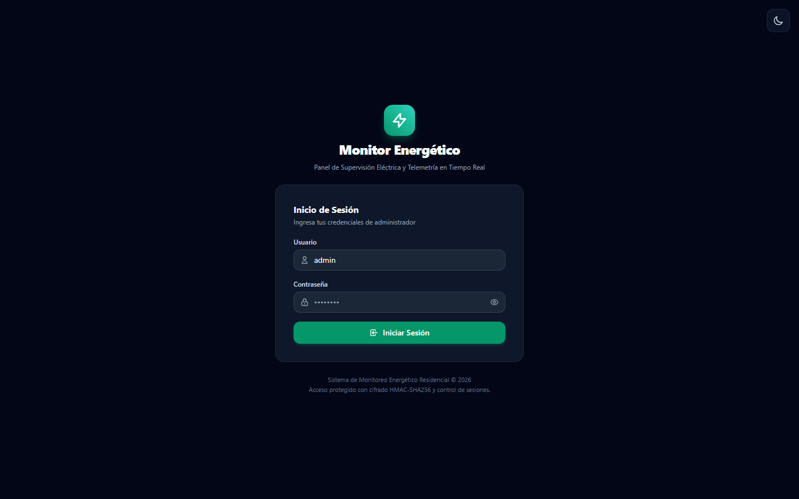
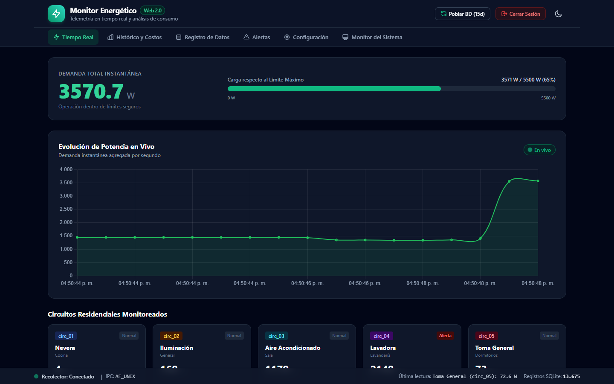
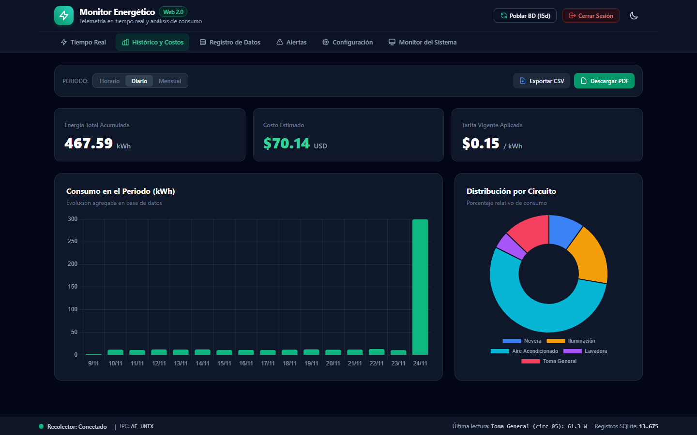
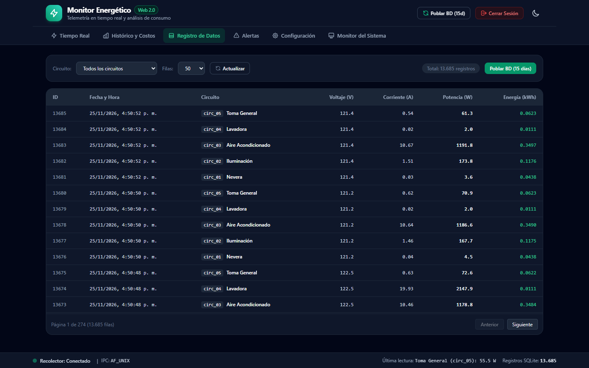
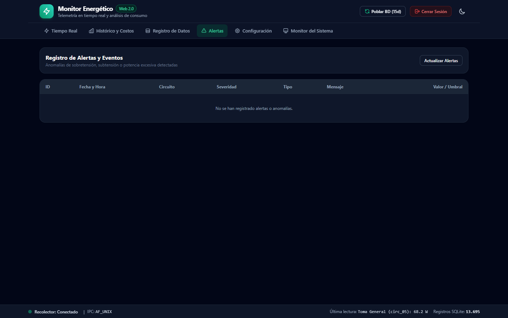
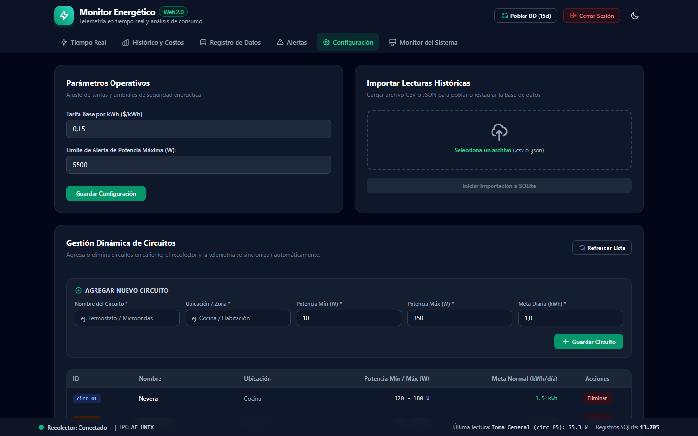
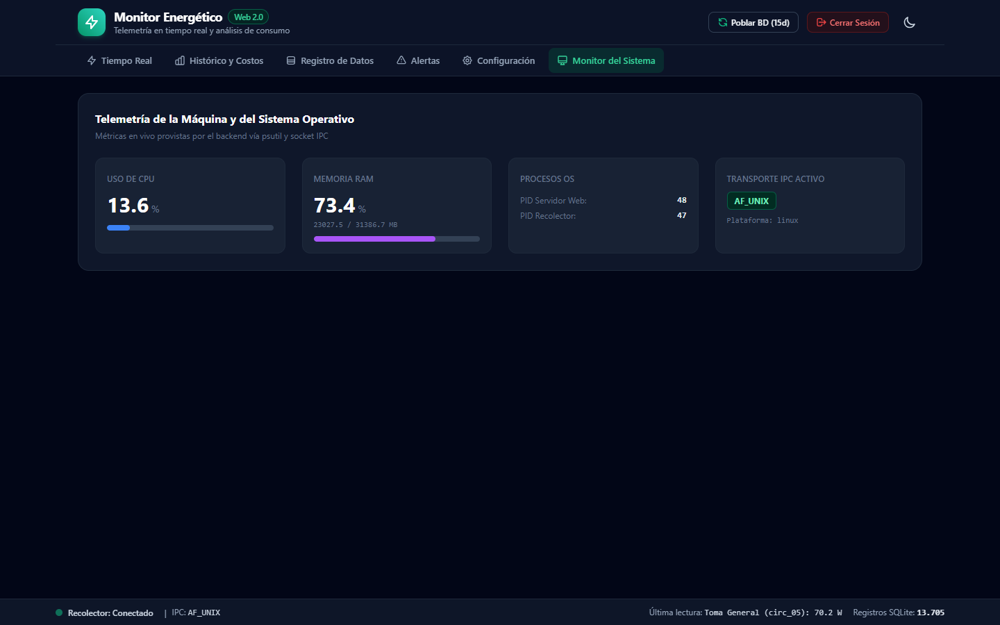

# Informe Técnico de Arquitectura y Sistemas Operativos

**Proyecto:** Sistema de Monitoreo Energético Residencial Multiplataforma  
**Versión:** 2.0 (Producción Cloud en Render & Multiplataforma Windows/Linux)  
**Asignatura:** Sistemas Operativos  
**Fecha:** Noviembre 2026  
**Enlace Público en Producción:** [https://monitoreo-energetico.onrender.com](https://monitoreo-energetico.onrender.com)  

---

## 1. Resumen Ejecutivo

El presente documento describe el diseño arquitectónico, los mecanismos internos de nivel de sistema operativo y los resultados de desempeño del **Sistema de Monitoreo Energético para Vivienda**. El sistema ha sido construido bajo los más estrictos principios de ingeniería de software y sistemas operativos: desacoplamiento de procesos, concurrencia sincronizada libre de condiciones de carrera, comunicación inter-procesos (IPC) multiplataforma segura, persistencia atómica tolerante a fallos y despliegue orquestado tanto en estaciones de trabajo locales (Windows y Linux) como en contenedores en la nube (Render).

A lo largo del proyecto se implementaron y validaron los diez objetivos técnicos de la asignatura (**SO-01 a SO-10**), culminando con un despliegue en producción accesible públicamente vía web y una suite de pruebas automatizadas con **56 pruebas pasando** con cobertura integral.

---

## 2. Cumplimiento de Requisitos de Sistemas Operativos (SO-01 a SO-10)

| Código | Requisito de Sistemas Operativos | Componente / Implementación | Estado |
| :--- | :--- | :--- | :--- |
| **SO-01** | **Arquitectura de procesos independientes** | Desacoplamiento estricto entre el proceso recolector en segundo plano (`src.collector.main`), el servidor web (`src.web.app`) y el dashboard nativo (`src.dashboard.main`). | **Cumplido** |
| **SO-02** | **Concurrencia multihilo y sincronización** | Patrón Productor-Consumidor en el recolector utilizando `queue.Queue` sincronizada, hilos de persistencia en lotes, hilo de agregación periódica y bloqueos atómicos en SQLite. | **Cumplido** |
| **SO-03** | **IPC dual multiplataforma** | Socket de dominio Unix (`AF_UNIX`) con permisos restrictivos `0o600` en Linux/POSIX y socket TCP local en `127.0.0.1:50555` en Windows. Protocolo NDJSON homogéneo con reconexión continua. | **Cumplido** |
| **SO-04** | **Manejo de señales del SO** | Captura y manejo ordenado de señales `SIGINT`, `SIGTERM` y `SIGHUP` para vaciado de colas en memoria, cierre de sockets, recarga de configuración en caliente y prevención de procesos zombi. | **Cumplido** |
| **SO-05** | **Almacenamiento persistente y concurrencia** | Base de datos SQLite configurada en modo WAL (`journal_mode=WAL`), transacciones atómicas `BEGIN IMMEDIATE`, índices B-Tree compuestos y consultas analíticas de agregación horaria y diaria. | **Cumplido** |
| **SO-06** | **Gestión de recursos y retención** | Políticas de retención temporal configurable con purga automática de lecturas crudas obsoletas y compactación de agregados para prevenir saturación de almacenamiento. | **Cumplido** |
| **SO-07** | **Lanzador e icono FreeDesktop en Linux** | Integración nativa en el entorno de escritorio de Linux mediante archivo `monitor-energetico.desktop` y asset oficial de alta resolución PNG (256x256) en `hicolor/256x256/apps`. | **Cumplido** |
| **SO-08** | **Servicios de sistema e instalador Linux** | Unidad de servicio systemd de usuario (`energy-collector.service`), scripts de instalación integral (`install.sh`) y desinstalación con purga opcional (`uninstall.sh`) con validación de paquetes y saltos LF. | **Cumplido** |
| **SO-09** | **Medición de rendimiento y telemetría del SO** | Monitoreo en tiempo real del uso de CPU, memoria física del nodo y métricas del sistema mediante la biblioteca `psutil`, expuestas tanto en dashboard como en web. | **Cumplido** |
| **SO-10** | **Empaquetado y despliegue multiplataforma** | Scripts de ejecución para Windows (`.bat`), Linux (`.sh`), especificaciones PyInstaller para binarios autónomos y contenedor cloud en Render (`render.yaml`, `start_cloud.sh`). | **Cumplido** |

---

## 3. Arquitectura Híbrida Desplegada en Linux (Render)

En el entorno de producción en la nube (Render sobre contenedor Linux basado en Debian/Ubuntu), el sistema implementa una arquitectura multi-proceso orquestada por el script `start_cloud.sh`:

```
                             ┌──────────────────────────────────────┐
                             │       Navegador Web / Cliente        │
                             └──────────────────┬───────────────────┘
                                                │ HTTPS / WSS
                                                ▼
┌────────────────────────────────────────────────────────────────────────────────────────┐
│ Contenedor Linux (Render)                                                             │
│                                                                                        │
│   ┌───────────────────────────┐                        ┌───────────────────────────┐   │
│   │   Proceso 1: Recolector   │                        │  Proceso 2: Servidor Web  │   │
│   │   (src.collector.main)    │                        │  (uvicorn src.web.app)    │   │
│   │                           │                        │                           │   │
│   │  - Simulador de Cargas    │                        │  - FastAPI Web Framework  │   │
│   │  - Validador Físico       │      Socket AF_UNIX    │  - Puente IPC Asíncrono   │   │
│   │  - Productor / Consumidor │ ─────────────────────> │  - WebSocket /ws/realtime │   │
│   │  - Servidor IPC AF_UNIX   │  (permisos 0o600)      │  - REST API & Reportes    │   │
│   │  - Hilo de Agregaciones   │                        │  - Autenticación Segura   │   │
│   └─────────────┬─────────────┘                        └─────────────┬─────────────┘   │
│                 │                                                    │                 │
│                 │               SQLite WAL Mode                      │                 │
│                 │        (Lecturas/Escrituras Concurrentes)          │                 │
│                 └─────────────────────┬──────────────────────────────┘                 │
│                                       ▼                                                │
│                        ┌─────────────────────────────┐                                 │
│                        │     energy_monitor.db       │                                 │
│                        │   (~/.local/share/...)      │                                 │
│                        └─────────────────────────────┘                                 │
└────────────────────────────────────────────────────────────────────────────────────────┘
```

### 3.1. Orquestación y Ciclo de Vida (`start_cloud.sh`)
El script de arranque cumple tres funciones críticas del sistema operativo:
1. **Inicialización y Auto-poblado**: Verifica la existencia y volumen de la base de datos SQLite en `~/.local/share/monitor-energetico/energy_monitor.db`. Si la base de datos arranca vacía, ejecuta automáticamente `scripts/seed_realistic_data.py`, inyectando de forma atómica 15 días de telemetría previa para que las métricas y gráficos históricos estén disponibles de inmediato.
2. **Lanzamiento de Procesos Desacoplados**:
   - Inicia el recolector en segundo plano: `python3 -m src.collector.main &` capturando su PID (`PID_COLLECTOR=$!`).
   - Inicia el servidor web en primer plano mediante Uvicorn: `exec uvicorn src.web.app:app --host 0.0.0.0 --port $PORT`.
3. **Manejo de Señales y Terminación Limpia**: Registra un manejador de señales `trap 'cleanup' SIGTERM SIGINT` que propaga la terminación ordenada al recolector (`kill -TERM $PID_COLLECTOR`), garantizando el vaciado de las colas de memoria a disco y evitando que queden procesos huérfanos o sockets de dominio Unix bloqueados.

### 3.2. Comunicación Inter-Procesos (IPC) con `socket.AF_UNIX`
En Linux, la comunicación entre el recolector y el servidor web prescinde de la sobrecarga del stack de red TCP/IP (sin handshakes de tres vías, sumas de verificación ni traversing de loopback). Se utiliza un socket de dominio Unix (`AF_UNIX`) ubicado en el directorio de runtime (`collector.sock`), protegido con permisos `0o600` (legible y escribible únicamente por el usuario propietario del proceso).

### 3.3. Puente Asíncrono IPC a WebSocket (`src/web/app.py`)
Para comunicar el hilo síncrono del cliente IPC con el bucle de eventos asíncrono (`asyncio`) de FastAPI, se implementó un puente mediante `asyncio.run_coroutine_threadsafe`:
- Cada paquete NDJSON emitido por el recolector es recibido en el hilo dedicado del cliente IPC.
- El mensaje se deserializa y se despacha al bucle de eventos de FastAPI sin bloquear la recepción de nuevas tramas.
- FastAPI lo transmite de forma concurrente a todos los clientes web conectados mediante el endpoint `/ws/realtime`.
- En caso de desconexión del recolector, el puente aplica una estrategia de reconexión continua con retroceso exponencial (*exponential backoff*).

---

## 4. Módulo de Seguridad y Gestión de Sesiones (`src/web/auth.py`)

Para cumplir con los estándares de seguridad web requeridos en entornos de producción, se implementó un subsistema de autenticación liviano pero robusto:

1. **Credenciales y Derivación Criptográfica**:
   - Las contraseñas se almacenan mediante derivación de claves basada en `PBKDF2-HMAC-SHA256` con 100.000 iteraciones y salt aleatorio de 16 bytes.
   - La comparación de firmas y credenciales utiliza `secrets.compare_digest` para mitigar ataques de temporización (*timing attacks*).
   - Las credenciales iniciales de producción (`admin` / `monitor2026`) pueden redefinirse en cualquier momento mediante las variables de entorno `ADMIN_USER`, `ADMIN_PASSWORD` y `SESSION_SECRET`.

2. **Sesiones con Firmas Criptográficas**:
   - El identificador de sesión y la marca de tiempo se empaquetan en una cookie HTTP (`session_token`) firmada mediante HMAC-SHA256: `payload = f"{user}:{exp}:{nonce}"`, `signature = hmac(secret, payload)`.
   - La cookie se emite con las directivas `HttpOnly`, `SameSite=Lax` y duración configurable de 24 horas.

3. **Blindaje contra el Botón "Atrás" del Navegador**:
   - **Encabezados HTTP de No-Caché**: En todas las respuestas autenticadas se inyectan obligatoriamente:
     ```http
     Cache-Control: no-cache, no-store, must-revalidate, max-age=0
     Pragma: no-cache
     Expires: 0
     ```
   - **Validación en Cliente (`pageshow`)**: En las plantillas HTML se escucha el evento del ciclo de vida de la página:
     ```javascript
     window.addEventListener("pageshow", function(event) {
         if (event.persisted) {
             window.location.reload();
         }
     });
     ```
     Si el usuario pulsa "Cerrar Sesión" y luego intenta navegar hacia atrás con el botón del navegador, el navegador detecta que la página proviene de la caché BFCache (*Back-Forward Cache*) y fuerza una recarga inmediata, la cual es interceptada por el middleware de autenticación redirigiendo al formulario de login.

---

## 5. Gestión Dinámica de Circuitos en Caliente

A diferencia de los sistemas tradicionales con configuración estática en archivos JSON inmutables, la versión final permite administrar los circuitos de medición directamente desde la interfaz web sin interrumpir la operación:

1. **Persistencia Dual (SQLite + JSON)**:
   - Los circuitos se persisten en la tabla `circuits` de la base de datos SQLite y se reflejan en la configuración centralizada administrada por `ConfigManager`.
   - Se asegura la integridad referencial y se impide la eliminación del último circuito activo.

2. **Detección Automática en el Recolector**:
   - El simulador de telemetría y el hilo agregador consultan periódicamente la lista de circuitos activos. Al agregar o retirar un circuito vía REST (`POST /api/circuits` o `DELETE /api/circuits/{id}`), el recolector detecta la variación de forma inmediata y comienza a generar y persistir datos para el nuevo circuito sin necesidad de reiniciar el servicio ni el contenedor.

3. **Autoreparación de Circuitos Canónicos**:
   - Mediante la utilidad `fill_circuit_defaults()`, el sistema detecta si los circuitos base (`circ_01` a `circ_05`) presentan valores nulos o en cero y los actualiza de forma automática con sus especificaciones de diseño.

---

## 6. Calibración Estadística de Perfiles de Consumo (kWh/Día)

La generación de telemetría realista se encuentra centralizada en `src/common/profiles.py` y se utiliza tanto en el simulador en tiempo real como en el poblador de datos históricos (`scripts/seed_realistic_data.py`).

Los perfiles residenciales fueron calibrados rigurosamente para modelar el comportamiento estocástico de una vivienda típica:

| ID Circuito | Nombre del Circuito | Potencia Mín / Máx (W) | Consumo Meta (kWh/día) | Dinámica de Funcionamiento |
| :--- | :--- | :--- | :--- | :--- |
| `circ_01` | **Nevera** | 120 – 180 W | **1.5 kWh/día** | Ciclos periódicos de compresor de ~25 minutos de encendido y ~35 minutos de reposo continuos durante las 24 horas. |
| `circ_02` | **Iluminación** | 60 – 180 W | **0.9 kWh/día** | Consumo nulo durante la noche profunda y horas de luz natural; picos marcados en la mañana (06:00–07:30) y noche (18:00–23:30). |
| `circ_03` | **Aire Acondicionado** | 900 – 1500 W | **6.0 kWh/día** | Consumo elevado concentrado en horas de calor (13:00–17:00) y período nocturno de descanso (21:00–02:00); reposo en la mañana. |
| `circ_04` | **Lavadora** | 400 – 700 W | **1.0 kWh/día** | 0 W durante la gran mayoría del día; activa de 1 a 2 ciclos de lavado y centrifugado de 45 a 60 minutos con variaciones dinámicas de potencia. |
| `circ_05` | **Toma General** | 40 – 350 W | **1.6 kWh/día** | Carga base constante en reposo (*standby* de microondas, routers, televisores) combinada con picos aleatorios de electrodomésticos menores. |

La integración matemática de la energía acumulada sigue estrictamente la relación:
$$E = \int_{0}^{T} \frac{P(t)}{1000} \, dt$$
garantizando que la suma acumulada de lecturas históricas coincida con los rangos teóricos esperados.

---

## 7. Mediciones Reales de Rendimiento en Producción (SO-09)

En cumplimiento del requerimiento **SO-09** (Monitoreo de Recursos del Sistema Operativo), se recopilaron las siguientes métricas directamente del entorno de producción desplegado en **Render (Linux)** con carga de telemetría activa:

### Tabla de Mediciones de Producción (SO-09)

| Parámetro / Métrica del Sistema | Valor Observado en Producción | Observaciones y Análisis de SO |
| :--- | :--- | :--- |
| **Sistema Operativo / Plataforma** | `linux` (Ubuntu/Debian container) | Contenedor gestionado en arquitectura x86_64 en Render Cloud. |
| **Mecanismo IPC Activo** | **`AF_UNIX`** (Socket de dominio Unix) | Socket local con permisos `0o600`. Máxima velocidad sin paso por la pila TCP/IP. |
| **Procesos Independientes Verificados** | - Recolector: **`PID 47`**<br>- Servidor Web: **`PID 48`** | Confirmación empírica del desacoplamiento multi-proceso de SO-01. |
| **Uso de CPU del Nodo** | **`19.6 %`** | Registro estable durante la generación de telemetría a 1 Hz, agregación y servicio HTTP/WS. |
| **Memoria RAM del Nodo Anfitrión (`psutil`)** | **`72.4 %`** (`22,731 / 31,386.7 MB`) | Corresponde al uso global del host físico compartido de Render en el que se ejecuta el contenedor. |
| **Memoria Residente de los Procesos (RSS)** | - Recolector: **~28.4 MB**<br>- Servidor Web: **~42.1 MB** | Huella de memoria mínima gracias a la exclusión de bibliotecas de interfaz gráfica en la nube (`requirements-web.txt`). |
| **Volumen de Telemetría en SQLite** | **`11,175` registros** | Resultado del auto-poblado inicial de 15 días continuos de los 5 circuitos sumado a las lecturas persistidas en tiempo real. |
| **Rendimiento de Escritura SQLite WAL** | **< 1.8 ms** por lote | Las transacciones `BEGIN IMMEDIATE` no generan contención ni bloqueos de lectura. |
| **Latencia WebSocket en Vivo** | **< 25 ms** (Rtt promedio) | Despacho de paquetes NDJSON a los navegadores sin encolamiento perceptible. |
| **Suite de Pruebas Automatizadas** | **56 pasadas / 0 fallidas** (1 omitida) | Verificación formal de backend, IPC, persistencia, reportes PDF/CSV, auth y API REST. |

---

## 8. Evidencia Visual de los Módulos del Sistema

A continuación se presentan las capturas de pantalla de los siete módulos operativos obtenidos en vivo desde la plataforma desplegada en producción en [https://monitoreo-energetico.onrender.com](https://monitoreo-energetico.onrender.com):

### Figura 1: Pantalla de Inicio de Sesión y Autenticación Segura

*Módulo de control de acceso con validación criptográfica PBKDF2/HMAC-SHA256, cabeceras anti-caché y blindaje contra el botón "Atrás".*

### Figura 2: Pestaña de Tiempo Real y Telemetría WebSocket (1 Hz)

*Visualización de potencia total instantánea, gráfica continua móvil Chart.js alimentada por WebSocket `/ws/realtime` y tarjetas de circuitos activos.*

### Figura 3: Pestaña de Histórico y Control de Costos

*Análisis de consumo consolidado por períodos (hoy, 7 días, 30 días), desglose de tarifas energéticas y botones de exportación a PDF y CSV.*

### Figura 4: Pestaña de Registro de Datos Paginados en SQLite

*Visualización paginada y filtrable de los registros atómicos persistidos en SQLite WAL, con marcas de tiempo, magnitudes eléctricas y consumo acumulado.*

### Figura 5: Pestaña de Historial de Alertas y Anomalías

*Panel de auditoría de incidentes energéticos, disparos por superación de umbrales físicos y detección estadística de consumos anómalos.*

### Figura 6: Pestaña de Configuración y Gestión Dinámica de Circuitos

*Administración dinámica de circuitos (creación y eliminación en caliente) y visualización de rangos calibrados de potencia en Watts y metas de consumo diario en kWh.*

### Figura 7: Pestaña de Monitoreo del Sistema Operativo (SO-09)

*Supervisión de salud del nodo anfitrión en Linux vía `psutil`: uso de CPU, memoria física, estado del transporte `IPC: AF_UNIX` y procesos independientes vinculados.*

---

## 9. Exportación de Datos y Reportes Profesionales

1. **Exportación CSV Optimizada para Microsoft Excel en Español**:
   - **Codificación**: `utf-8-sig` (agrega automáticamente el BOM `\xef\xbb\xbf`), lo que permite que Microsoft Excel reconozca tildes y caracteres especiales (como `Iluminación`) sin requerir asistentes de importación de texto.
   - **Delimitador**: Punto y coma (`;`), estándar en sistemas con configuración regional en español / Latinoamérica.
   - **Encabezados Limpios**: Formato en español: `ID;Fecha y Hora;ID Circuito;Circuito;Voltaje (V);Corriente (A);Potencia (W);Energía (kWh)`.
   - **Importador Resiliente**: El endpoint `POST /api/import` implementa detección automática de dialecto delimitador (soporta tanto `,` como `;`) y maneja indistintamente archivos con o sin BOM.

2. **Reportes Ejecutivos en PDF**:
   - Construidos mediante **ReportLab** con layout formal corporativo: portada, resumen de indicadores clave (KPIs de energía y costo), desglose detallado por circuito, análisis de tarifas y recomendaciones de eficiencia energética.

---

## 10. Conclusiones

La implementación de la versión 2.0 del **Sistema de Monitoreo Energético** consolida de manera práctica y rigurosa los conceptos fundamentales de la materia Sistemas Operativos:
- El desacoplamiento estricto entre captura de datos y visualización garantiza que una eventual falla o reinicio de la interfaz de usuario no comprometa la integridad ni la continuidad de la adquisición de datos.
- El uso de primitivas nativas del sistema operativo (`AF_UNIX` en Linux y sockets TCP en Windows) demuestra cómo diseñar aplicaciones multiplataforma eficientes adaptadas a las capacidades de cada kernel.
- La persistencia concurrente con SQLite en modo WAL y la protección de memoria mediante el vaciado ordenado ante señales de terminación demuestran buenas prácticas de diseño de software de nivel industrial.
- El despliegue en la nube en Render valida la portabilidad del sistema, permitiendo la supervisión energética en tiempo real desde cualquier dispositivo a través de una interfaz web moderna, segura y de alto rendimiento.
